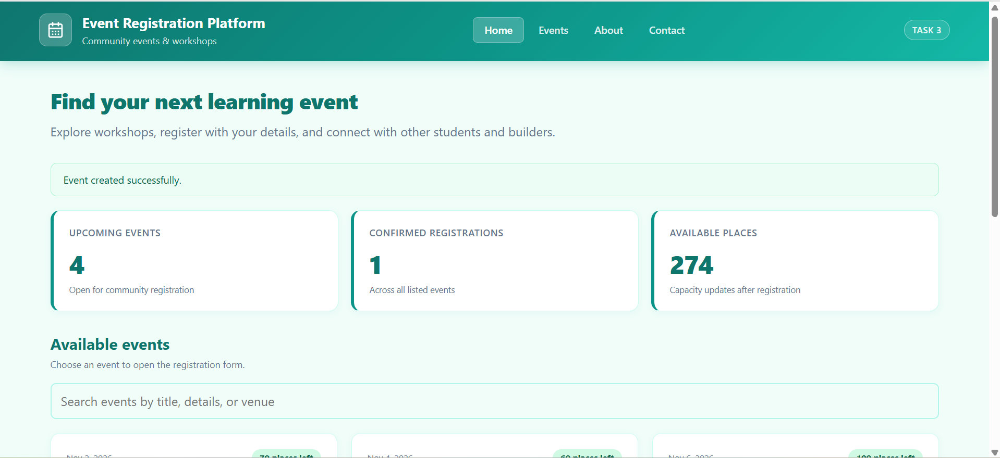
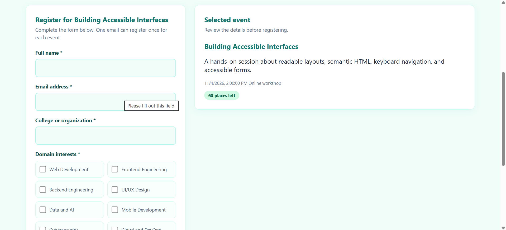
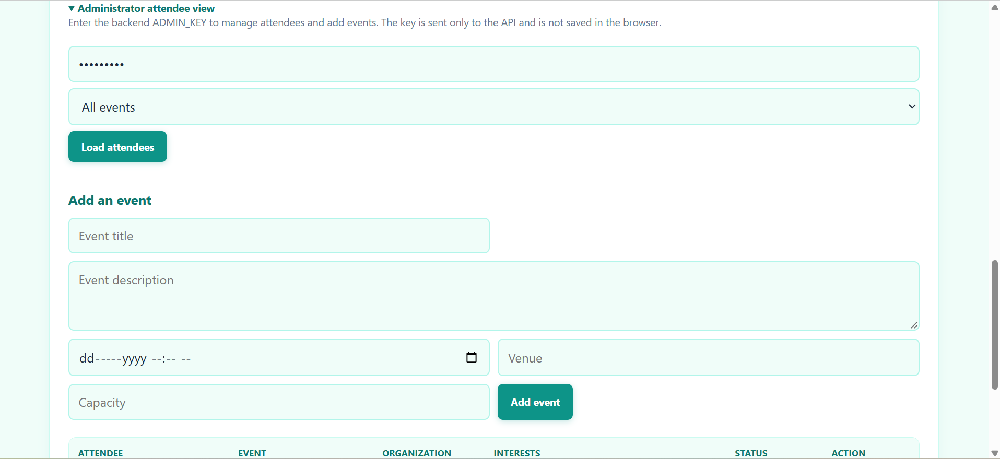
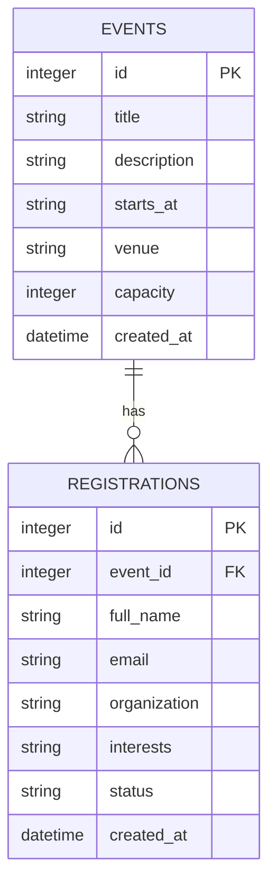

# Event Registration Platform (Task 3)

> **CodeNova Full Stack Internship - Batch 01**
> Remote / Online | 4 Weeks Self-Paced | Deadline: 06 November 2026

A multi-event registration portal where users browse upcoming tech events, see live seat availability, and register with their details. An admin panel lets moderators view and manage all registrations per event.

---

## Screenshots







---

## Tech Stack

| Layer | Technology |
| :--- | :--- |
| **Frontend** | React 19 + Vite, Inter font |
| **Backend** | Node.js + Express (ESM) |
| **Database** | PostgreSQL via Supabase and `pg` |
| **Styling** | Custom CSS — navy/green theme, responsive layout |
| **Auth** | Admin key via `x-admin-key` request header |

---

## Features

- Event listing with live capacity tracking — remaining seats updated after each registration
- Registration form with full server-side validation (email format, duplicate guard, field lengths)
- Duplicate prevention — the same email cannot register for the same event twice (`409 Conflict`)
- Three seeded demo events on first start (Modern Web Dev, Data & AI Essentials, Cloud & DevOps)
- Admin-protected route to view all registrations per event
- Admin can update registration status (`confirmed` / `cancelled`)
- Cascade deletion — removing an event automatically wipes its registrations

---

## Project Structure

```text
task-3-event-registration/
├── backend/
│   ├── src/
│   │   ├── db.js              # PostgreSQL connection pool and migrations
│   │   ├── server.js          # Express entry point
│   │   ├── validation.js      # Registration field validation
│   │   └── routes/
│   │       ├── events.js
│   │       └── admin.js
│   ├── data/.gitkeep
│   └── .env.example
├── frontend/
│   ├── src/
│   │   ├── components/
│   │   │   ├── AdminPanel.jsx
│   │   │   ├── EventCard.jsx
│   │   │   ├── LoadingState.jsx
│   │   │   ├── Notice.jsx
│   │   │   └── RegistrationForm.jsx
│   │   ├── App.jsx
│   │   ├── api.js
│   │   └── styles.css
│   ├── .env
│   └── vite.config.js
├── screenshort1.png
├── screenshort2.png
├── screenshort3.png
└── README.md
```

---

## Database Model



---

## API Reference

**Base URL:** `http://localhost:5003/api`

| Method | Route | Description |
| :--- | :--- | :--- |
| `GET` | `/health` | Health check |
| `GET` | `/events` | Public event list with registration counts and remaining capacity |
| `POST` | `/events/:id/register` | Register an attendee — `409` if duplicate or event full |
| `GET` | `/admin/registrations` | Admin: all registrations, optional `?event_id=` filter |
| `PATCH` | `/admin/registrations/:id/status` | Admin: update status to `confirmed` or `cancelled` |

**Admin routes** require the `x-admin-key` header matching the backend `ADMIN_KEY` env var.

### Registration POST body

```json
{
  "full_name": "Jane Doe",
  "email": "jane@example.com",
  "organization": "State University",
  "interests": ["React", "Node.js", "Cloud"]
}
```

---

## Local Setup

### Prerequisites
- Node.js v20+
- npm

### Backend (port 5003)

```bash
cd task-3-event-registration/backend
npm install
cp .env.example .env
# Set ADMIN_KEY in .env before using admin routes
npm run dev
# API running at http://localhost:5003
```

### Frontend (port 5174)

```bash
cd task-3-event-registration/frontend
npm install
npm run dev
# Open http://localhost:5174
```

### From the repo root

```bash
npm run backend:task3   # Start backend  → http://localhost:5003
npm run frontend:task3  # Start frontend → http://localhost:5174
```

---

## Deployment

| Target | Platform | Config |
| :--- | :--- | :--- |
| Frontend | Vercel | Root: `frontend`, Build: `npm run build`, Output: `dist`, Env: `VITE_API_URL` |
| Backend | Render | Root: `backend`, Start: `npm start`, Env: `PORT`, `ADMIN_KEY`, `DATABASE_URL`, `FRONTEND_ORIGIN` |

---

## Security Notes

- Admin routes are gated by `x-admin-key` — set a long private key in `.env`, never commit it
- The unique `(event_id, email)` database constraint prevents duplicate registrations even under concurrent requests
- See [DATABASE_SETUP.md](./DATABASE_SETUP.md) for Supabase, migration, and Render setup.
